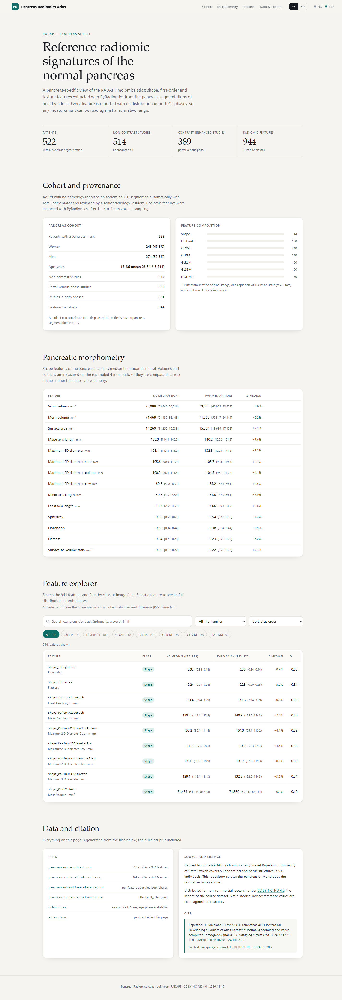
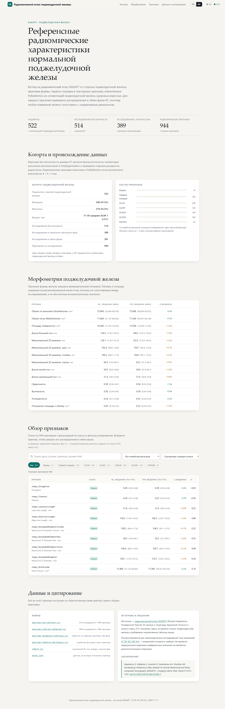

# Радиомический атлас поджелудочной железы

Атлас референсных радиомических признаков поджелудочной железы для КТ органов брюшной полости,
сформированный на основе [радиомического атласа RADAPT](https://github.com/eliskape/Radiomics-Atlas)
(Kapetanou et al., 2024).

В исходном наборе RADAPT опубликованы признаки PyRadiomics для 53 органов и анатомических структур
531 пациента. В этом репозитории оставлена только поджелудочная железа, сохранены все извлечённые
признаки для обеих фаз КТ и добавлена нормативная статистика, которая превращает таблицу признаков
в инструмент, с которым можно сопоставить измерение конкретного пациента: перцентили,
межквартильные интервалы и различия между фазами для всех 944 признаков.

* **522** пациента с сегментацией поджелудочной железы (248 женщин, 274 мужчины; 17–36 лет,
  средний возраст 26,8 ± 5,2 года)
* **514** исследований без контраста (NC) и **389** исследований в портально-венозную фазу (PVP),
  у 381 пациента доступны обе фазы
* **944** признака PyRadiomics: 14 shape, 180 first order, 240 GLCM, 140 GLDM, 160 GLRLM,
  160 GLSZM, 50 NGTDM
* **10** семейств фильтров: исходное изображение, фильтр Лапласа–Гаусса (σ = 5 мм) и восемь
  вейвлет-разложений

## Страница атласа

Файл `index.html` — самостоятельная статическая страница (без сборки и без внешних запросов):

* сводка по когорте и происхождению данных;
* морфометрия железы — медиана [межквартильный интервал] для объёма, осей, сферичности и площади
  поверхности в обеих фазах;
* интерактивный поиск по всем 944 признакам с фильтрами по классу и семейству фильтров,
  сортировкой по величине межфазового различия и панелью признака с гистограммой распределения
  и таблицей квантилей;
* переключатель языков EN/RU: при первом визите язык берётся из настроек браузера, выбор
  запоминается в `localStorage`, атрибут `<html lang>` обновляется вместе с ним.

**Английский интерфейс**



**Русский интерфейс**



Локальный просмотр:

```bash
python3 -m http.server 8000     # из корня репозитория
# затем открыть http://localhost:8000
```

На GitHub включите **Settings → Pages → Source: GitHub Actions** — приложенный workflow
(`.github/workflows/pages.yml`) будет публиковать атлас при каждом пуше в основную ветку.

## Структура репозитория

| Путь | Содержимое |
|------|------------|
| `index.html`, `assets/` | страница атласа, стили, скрипт и его JSON-данные |
| `data/pancreas-non-contrast.csv` | 514 исследований × 944 признака, КТ без контраста |
| `data/pancreas-contrast-enhanced.csv` | 389 исследований × 944 признака, портально-венозная фаза |
| `data/pancreas-normative-reference.csv` | референсная статистика по каждому признаку для обеих фаз |
| `data/pancreas-features-dictionary.csv` | признак → семейство фильтров, класс, название, единицы |
| `data/cohort.csv` | анонимный ID, пол, возраст, наличие фаз |
| `data/README.md` | описание столбцов перечисленных файлов |
| `scripts/build_atlas.py` | пересобирает все файлы в `data/` и данные для страницы |
| `LICENSE.md` | CC BY-NC-ND 4.0, лицензия исходного набора данных |

## Морфометрия поджелудочной железы

Медианы, без контраста / портально-венозная фаза:

| Показатель | NC | PVP |
|---|---|---|
| Объём (MeshVolume, маска после ресэмплинга) | 71,5 см³ | 71,4 см³ |
| Длина большой оси | 130,3 мм | 140,2 мм |
| Длина малой оси | 50,5 мм | 54,0 мм |
| Максимальный 3D-диаметр | 128,1 мм | 132,5 мм |
| Площадь поверхности | 142,6 см² | 153,0 см² |
| Сферичность | 0,583 | 0,541 |

Объём и площадь поверхности измерены на маске, ресэмплированной до 4 × 4 × 4 мм, — это
гармонизированные, а не абсолютные волюметрические значения. Признаки формы рассчитаны по
сегментации каждой серии отдельно, поэтому между фазами они немного различаются, хотя сама
железа не меняется.

## Нормативная статистика

В файле `pancreas-normative-reference.csv` для каждого признака и каждой фазы приведены:
число исследований, среднее, стандартное отклонение, медиана, p5, p25, p75, p95, минимум
и максимум, а также `cohens_d_pvp_vs_nc` — стандартизованная разность средних между фазами
(PVP минус NC). Эти же числа используются на странице атласа.

Это непараметрические референсные интервалы для когорты здоровых молодых взрослых, а не
диагностические пороги. Значение за пределами p5–p95 необычно для данной когорты, но не
обязательно является патологией.

## Происхождение данных

Данные получены из RADAPT: аксиальная КТ с толщиной среза 3,75 мм на 64-срезовых сканерах
GE или Siemens (120 кВ, коллимация 40 мм, FOV 500 × 500 мм, матрица 512 × 512), йодистый контраст
370 мг I/мл, 1 мл/кг, 4 мл/с, портально-венозная фаза на 70-й секунде. Маски поджелудочной
железы получены в TotalSegmentator (3D Slicer 5.2.1) и проверены старшим резидентом радиологии.
Признаки извлечены в PyRadiomics с шириной бина 25 HU и ресэмплингом вокселей 4 × 4 × 4 мм.

Исходные данные и полный атлас по 53 структурам:
<https://github.com/eliskape/Radiomics-Atlas>.

## Воспроизведение сборки

```bash
python3 -m venv .venv
.venv/bin/pip install -r scripts/requirements.txt

# --source указывает на клон RADAPT с двумя книгами Excel по поджелудочной железе
.venv/bin/python scripts/build_atlas.py --source ../Radiomics-Atlas
```

Скрипт детерминирован, кроме даты генерации, которая попадает в подвал страницы.

## Ограничения

* Только здоровые молодые взрослые (17–36 лет): возрастные изменения паренхимы и жировой ткани
  не представлены.
* Одна фаза контрастирования (портально-венозная); артериальная и отсроченная фазы отсутствуют,
  поэтому фазовые особенности накопления контраста охарактеризовать нельзя.
* Данные одного центра (Университет Крита) и одного протокола сканирования.
* Из клинических характеристик доступны только пол и возраст; патологии нет — атлас описывает
  нормальную анатомию.
* Признаки формы рассчитаны на ресэмплированных масках; исследования воспроизводимости
  (test–retest, межоператорская согласованность) для масок поджелудочной железы в наборе
  не опубликованы.

## Лицензия и указание авторства

Данные по поджелудочной железе — курированное подмножество RADAPT, распространяемое под
лицензией исходного набора, **Creative Commons Attribution-NonCommercial-NoDerivatives 4.0
International** (см. [LICENSE.md](LICENSE.md)): только некоммерческое использование, с указанием
авторства и без распространения изменённых версий набора. Добавленная референсная статистика
предназначена для исследовательских и образовательных целей; для распространения изменённого
набора требуется разрешение авторов RADAPT.

При использовании данных цитируйте оригинальную публикацию:

> Kapetanou E, Malamas S, Leventis D, Karantanas AH, Klontzas ME. Developing a Radiomics Atlas
> Dataset of normal Abdominal and Pelvic computed Tomography (RADAPT).
> *Journal of Imaging Informatics in Medicine.* 2024;37:1273–1281.
> <https://doi.org/10.1007/s10278-024-01028-7>

Полный текст статьи: <https://link.springer.com/article/10.1007/s10278-024-01028-7>

Контакты авторов исходного набора: Michail E. Klontzas (miklontzas@ics.forth.gr),
Elisavet Kapetanou (elisavet.kapetanou@gmail.com).
